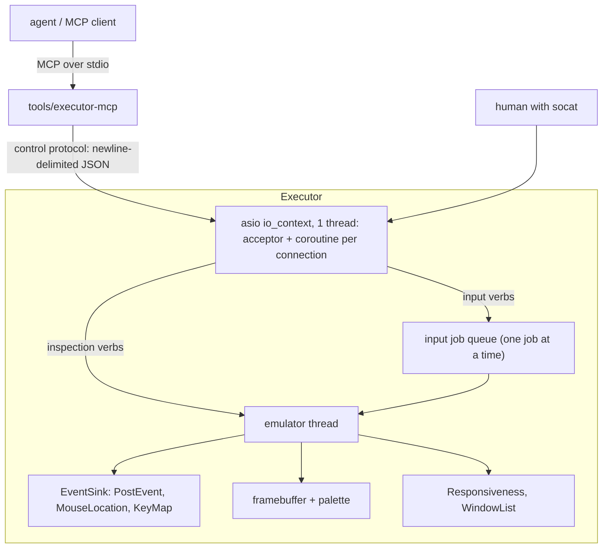

# Agent control of a running Executor session

> **AI-generated.** This document was produced with the assistance of an AI language
> model and may contain inaccuracies.

## Problem

We want an AI agent to drive an Executor session: look at the screen, click, type,
and observe what happened. Target use case for the first iteration is **interactive
exploration and debugging** — an agent (or a human, or both at once) poking at a
classic Mac application that is already running.

The transport must support **attaching to a session the user already started**, not
just sessions the agent spawns. That single requirement shapes most of what follows.

## Decisions

| Decision | Choice | Why |
|---|---|---|
| Where the controller lives | inside Executor | Only the process can read the framebuffer and post events on the emulator thread. |
| Emulator-side interface | a local control socket, enabled by `--control` | Runtime switch: no socket unless asked. It cannot gate link-time dependencies, so everything not needed by the controller stays out of process. |
| Socket layer | Boost.Asio + C++20 coroutines | One `io_context` thread; each connection is a straight-line `co_await` loop. The project now sets `CMAKE_CXX_STANDARD 20`. |
| Wire format | newline-delimited JSON, base64 image data | One framing rule: every message is one JSON object. JSON is text, so binary must be escaped — the same reason MCP base64s. `Boost::json` is already available. |
| Ordering of input | a job queue on the emulator thread | Two clients must not interleave the halves of a click. Serialization lives where the work is, so the socket layer needs no lock. |
| MCP implementation | `tools/executor-mcp`, C++, stdio transport | Attach works (it is a *client* of the socket). No HTTP, no Beast, no new language. |
| MCP placement | out of process | MCP's stdio transport cannot live inside a GUI app (stdin/stdout are spoken for), and its HTTP transport would put an HTTP server, an image codec and MCP version churn in the emulator. |
| Timing / determinism | real time; no pause in v1 | Explicit later iteration. |
| Screen settling | none in v1 | Clients sleep a second or two. Detecting "settled" correctly is hard; a wrong answer is worse than an honest sleep. |

## What the emulator already provides

| Piece | Where | Use |
|---|---|---|
| `EventSink::instance`, public virtual `mouseMoved`/`mouseButtonEvent`/`keyboardEvent` | `src/vdriver/eventsink.cpp`, `src/vdriver/vdriver.h` | The one input funnel. Injection here is indistinguishable from a real user, on every front-end. |
| `runOnEmulatorThread()` (private `EventSink` member) + `pumpEvents()` from a `syncint` `Interrupt` | `src/vdriver/eventsink.cpp`, `src/time/syncint.cpp` | The cross-thread hop. Moved out and made reusable by this work (see below). |
| Guest framebuffer + palette; pixel decode for 1/2/4/8/16/32 bpp | `src/vdriver/vdriver.h`, `src/vdriver/vdriver.cpp` (`updateBuffer`) | Screenshots. |
| `Responsiveness::lastResponseMs()` | `src/vdriver/responsiveness.h` | Thread-safe "the app pumped its event loop recently". |
| `ROMlib_SetKey`, `ROMlib_GetModifiers`, `KeyTranslate` | `src/osevent/osevent.cpp`, `src/toolevent.cpp:153` | Key injection and character→keycode mapping against the selected KCHR. |
| `ROMlib_send_quit` | `src/toolevent.cpp:648` | Graceful quit (exactly what the front-end's window close does). |
| `--record` / `--playback` | `src/vdriver/eventrecorder.cpp` | Agent-injected input is recorded too, so an agent-found bug becomes a replayable test. |

Existing pieces that are *not* the answer: `src/screen-dump.cpp` (Cmd-Shift-3; ≤8 bpp
indirect pixmaps only, writes a TIFF file), and the cxmon debugger (blocking,
interactive, single `interact()` entry point — it controls the CPU, not the UI).

## Architecture



Two layers, deliberately:

1. **Controller** (`src/control/`): socket, protocol, job queue, ops, keymap.
   Independently useful and testable.
2. **MCP front end** (`tools/executor-mcp`): JSON-RPC, tool schemas, PNG/base64,
   session discovery. It is the *client* of the control socket, so it can attach.

Build integration: add the new sources to the `romlib` target in
`src/CMakeLists.txt` and `json` to its `find_package(Boost COMPONENTS …)` line.
Asio is header-only; Boost.System is header-only in current Boost versions but add
`Boost::system` if a platform's Boost still wants it. `executor-mcp` goes in
`tools/CMakeLists.txt` and needs no `romlib` — only sockets, JSON and PNG. No new
CMake option.

### Why not in-process MCP

- **stdio cannot attach.** An stdio MCP server must be spawned by the client and own
  stdin/stdout. Executor's stdin is used by cxmon and its stdout carries logs, and a
  server started by the user's shell cannot be handed to a client.
- **Therefore in-process means Streamable HTTP**: `POST`/`GET`/`DELETE`, `Accept:
  application/json, text/event-stream` negotiation, `Mcp-Session-Id`, SSE,
  `Origin` validation, DNS-rebinding protection, a listening socket inside a GUI
  app. Boost.Beast makes it feasible, but it stops being thin, and locally
  configured MCP clients overwhelmingly expect stdio — HTTP is the remote path.
- **Protocol churn.** MCP revisions move; the emulator should not track them.

(The dependency argument no longer applies: `Boost::json` is in the emulator either
way. The decisive reasons are the two above.)

The split costs one extra process and one socket copy per screenshot (~3 MB at
32 bpp, ~1 ms over a Unix socket).

## Emulator-side design

### 1. A general emulator-thread seam

New `src/base/emulator_thread.{h,cpp}`:

```cpp
// Runs f on the emulator thread at the next interrupt safe point.
// Thread-safe.
void runOnEmulatorThread(std::function<void()> f);
```

This is the existing `EventSink::runOnEmulatorThread` (task list + `Interrupt::trigger()`),
moved out of `eventsink.cpp` into the new module so the control layer can use it. The
signature and behaviour are unchanged; `EventSink` is refactored onto it.

**Constraint (from `src/osevent/wheel.cpp`):** work runs inside
`Interrupt::handleCommon()`, with the guest registers saved. It may read guest
structs, the framebuffer and low-memory globals, and may `PostEvent` /
`ROMlib_PPostEvent`. It **must not** call traps that can run guest code
(`FindWindow`, `TrackControl`, `TrackGoAway`, …) or change `qdGlobals().thePort`.
Use the native `C_` implementations where a trap equivalent is needed.

### 2. Socket layer: Asio + coroutines

New `src/control/`: `controlserver.{h,cpp}` (acceptor, coroutines, dispatch),
`jobqueue.{h,cpp}` (input ordering and timing), `controlops.{h,cpp}` (the verbs),
`keymap.{h,cpp}` (character → keycode).

- **One `asio::io_context` on its own thread.** The acceptor and every connection
  are coroutines (`co_spawn(ioc, serve(sock), detached)`).
  `asio::local::stream_protocol` for `unix:`, `asio::ip::tcp::acceptor` for `tcp:`
  (`BOOST_ASIO_HAS_LOCAL_SOCKETS` covers Windows 10+ in current Boost; `tcp:` is
  the fallback).
- **Endpoint.** `--control auto|unix:<path>|tcp:<host>:<port>`, added to the
  "Automated Testing" option group in `src/main.cpp`. `auto` uses
  `$XDG_RUNTIME_DIR/executor/<pid>.sock` (falling back to `$TMPDIR`, then `/tmp`),
  creates it mode 0600, and prints `control endpoint: <...>` on stderr.
- **Lifecycle.** Started by the emulator thread as the last step of initialisation,
  immediately before `executor_main()` — after `traps::init`, `InitLowMem`,
  `ROMlib_InitGDevices`, `ROMlib_eventinit`, `InitResources` and `InitAppFiles`.
  Nothing can connect before the guest is usable, so there is no readiness flag and
  no "not ready" error: **the socket's existence is the readiness signal.** A spawner
  either passes `unix:<path>` itself or retries `connect()` on the pid-derived path
  until the file appears (bounded); for attach, any socket found under
  `$XDG_RUNTIME_DIR/executor/` names a usable session.
  One implementation note: a thread created from the emulator thread inherits the
  *unblocked* `SIGALRM` mask that `SyncintTimer::start()` installs there, so the io
  thread must block `SIGALRM` before it runs. The timer handler assumes only the
  emulator thread is eligible.
- **Shutdown.** As the emulator thread unwinds (guest quit, `ExitToShell`, `quit
  force`) it *requests* shutdown, posted to the io thread; that closes the listening
  socket and all connections, pending operations complete with `operation_aborted`,
  the coroutines unwind and `io_context::run()` returns. (asio objects are not
  thread-safe for concurrent use, so the close happens on the io thread, not on the
  emulator thread directly.) Pending jobs are cancelled so in-flight awaits finish
  promptly — they are *not* answered. `main` joins the io thread after
  `executorThread.join()` and before `vdriver.reset()`, so nothing can dereference a
  destroyed framebuffer. A command that was never processed simply gets no reply:
  the client sees the connection close, and `executor-mcp` reports that the session
  ended.
- **Display.** The controller never talks to the front-end or the window server.
  `frame` reads the guest framebuffer, so it behaves identically under Qt, Wayland,
  SDL, X11 and `--headless`.

The per-connection loop, in full:

```cpp
asio::awaitable<void> Server::serve(local::stream_protocol::socket sock)
{
    asio::streambuf buf(kMaxRequestLine);

    for(;;)
    {
        co_await asio::async_read_until(sock, buf, '\n', asio::use_awaitable);
        auto req = parse(consume_line(buf));          // may report bad-request

        auto resp = co_await runVerb(req);            // see below

        // `frame` base64s its pixels into `resp` here, on this thread; the
        // emulator thread only pays for the copy out of the framebuffer.
        std::string line = boost::json::serialize(resp) + '\n';
        co_await asio::async_write(sock, asio::buffer(line), asio::use_awaitable);
    }
}
```

**Two rules that matter:**

- **No `std::mutex` may be held across a `co_await`.** On a single-threaded
  `io_context` the same thread resumes another coroutine, and a non-recursive
  mutex locked by the suspended one self-deadlocks. Asio has no `async_mutex`, and
  we do not need one: ordering lives in the job queue (§3).
- **The emulator hop is not an asio operation, so it gets an adapter.** Blocking on
  a `std::future` inside a coroutine would stall the whole io thread (timers
  included), and `std::future` has no awaiter. `runVerb` is therefore built on an
  `async_initiate`-based helper (~35 lines, written once) that enqueues the work and
  **`asio::post`s the completion to the caller's executor** — asio handlers must
  never run on the emulator thread.

**Deadlines.** Every verb has one (default 5 s; `frame` 10 s). Race the operation
against `asio::steady_timer`. `asio::experimental::awaitable_operators` (`op ||
timer`) reads best; if we would rather not depend on the experimental namespace, a
hand-written two-slot completion is ~20 lines. Whichever we pick, the timer branch
must set the job's `cancelled` flag (§3) before replying `timeout`, otherwise a
timed-out click would still deliver its `mouseUp` later.

### 3. Input job queue: ordering and timing

A click is three actions tens of milliseconds apart (move, down, wait, up), so the
input verbs cannot be a burst of posts: losing the gaps makes apps see degenerate
clicks and breaks double-click detection.

`JobQueue` lives on the emulator thread and runs **one input job at a time**:

```cpp
struct Job
{
    std::atomic<bool> cancelled{false};
    // Executes the next step.  Returns a Response when finished, or the host
    // deadline at which step() should be called again.
    virtual std::variant<Response, std::chrono::milliseconds> step() = 0;
};
```

- **Serialization.** Jobs are queued (cap 32; beyond that `busy`). Because only one
  runs at a time, one client's `down` … `up` cannot be interleaved with another
  client's input. That is the whole reason the socket layer has no op lock.
- **Timing.** A dedicated timer thread sleeps until the earliest pending deadline
  and calls `Interrupt::trigger()`; the drain runs from that interrupt (the same
  wake mechanism `EventSink` uses from the GUI thread). We deliberately do **not**
  use `syncint_post()`: on POSIX `SyncintTimer::post()` *replaces* the itimer
  rather than keeping the minimum, and `timeInterruptHandler()` re-arms from its own
  bookkeeping, so a control deadline later than a Time Manager deadline would delay
  the guest's timer. If we ever want to drop the thread, the fix is to make
  `post()` take a minimum on POSIX too (the Windows path already does) — then
  `syncint_post` becomes safe for a second user.
- **Cancellation.** The socket side sets `cancelled` when its deadline expires; the
  job checks it at the start of each step and drops out. This is what makes "which
  op timed out" unambiguous.
- **Not queued.** Inspection verbs (`hello`, `screen`, `status`, `frame`) are
  read-only, short emulator-thread tasks; they run between the steps of an active
  input job rather than waiting behind it. `wait` is pure timing and does not touch
  the emulator at all.
- **Time base.** `msecs_elapsed()` (host monotonic), not Mac ticks. Double-click
  detection is guest-side (`TickCount()` vs `LM(DoubleTime)`), so `--timewarp`
  changes what counts as a double click even though pacing is unaffected.

Interrupt budget: `syncint` allows 10 (`maxInterrupts`); the seam takes over the
existing `EventSink` interrupt and the job queue adds one, so 3 of 10 are used.

### 4. Frame capture

`frame` reads the framebuffer **on the emulator thread**, for two reasons, neither of
which is about tearing:

- **One consistent response.** Geometry, palette (for indexed modes) and pixels come
  from the same point in guest execution, so `width`, `height` and `bpp` cannot
  disagree with the pixels being sent. Sampling them from another thread while the
  guest changes depth is a buffer-size bug, not a cosmetic one.
- **No front-end has to change its threading discipline.** The framebuffer's
  deliberate design is two threads: written by QuickDraw on the emulator thread,
  read by the front-end on the GUI thread, with the dirty-rect list (`mutex_`) as
  the handoff — and the buffer swap in `setMode()` happens on that reader's thread
  (Qt marshals the whole body to the GUI thread; Wayland's `updateMode()` runs in
  its event loop; headless has no reader at all). A third reader, the `io_context`
  thread, is outside that invariant. Making it safe is possible and explicit — copy
  the `shared_ptr<uint8_t>` and the geometry under `mutex_`, decode outside the
  lock, and take the lock in each front-end's `setMode()` — but it is work with no
  benefit here.

Reading on the emulator thread does **not** make frames "finished": the guest is
interruptible between a window frame and its contents, so a partially redrawn screen
is equally possible either way. That is why v1 has no stability detection and clients
sleep instead.

The cost is one posted task plus the copy (~3 MB at 1024×768×4, about a
millisecond) per frame, which is irrelevant at agent request rates.

Add a public method to `VideoDriver`:

```cpp
// ARGB8888, top-down, tightly packed, `rect` in guest screen coordinates.
// Reads the guest's actual pixels: no rootless hole mapping, no dim.
// Called on the emulator thread (see above).
void captureARGB(Rect rect, std::vector<uint32_t>& out) const;
```

Implemented by extracting the per-pixel decode currently inlined in
`updateBuffer()` into a shared helper in `vdriver.cpp`; `updateBuffer()` keeps its
existing behaviour (including the rootless/dim mapping, which `captureARGB` must
not apply). The pixels are copied into a buffer on the emulator thread; base64
encoding into the response object happens on the `io_context` thread, so the
emulator only pays for the copy.

Defaults: 8 bpp indexed at 1024×768 is what most classic apps expect; `--headless`
with no `--size`/`--bpp` gives 512×342 at **1 bpp**, which the MCP front end should
override by default and always report in `hello`.

**Not in scope for v1:** the guest cursor is a host hardware cursor and never
appears in the framebuffer, and we will not composite it into `frame`. Pointer
position, button state and modifiers are reported by `status` instead.

### 5. Input injection

All of it goes through `EventSink::instance`, i.e. the same path as real input.

- `move` → `EventSink::mouseMoved` → sets `LM(MouseLocation2)` /
  `LM(MouseLocation)` / `LM(MTemp)` and calls `adb_apeiron_hack()`. `PPostEvent`
  takes `where` from `LM(MouseLocation2)`, so the move must precede the down.
- `down`/`up` → `EventSink::mouseButtonEvent` → sets `LM(MBState)` (0 = down) and
  posts `mouseDown`/`mouseUp`.
- `click` → move, down, **wait `gap_ms`** (default 50), up. A zero-gap click is
  wrong: classic Mac apps receive `mouseDown`, then enter a tracking loop that reads
  the button state. `count > 1` repeats with `interval_ms` (default 30) between the
  up and the next down; `status` reports `GetDblTime()` so callers can see the
  threshold.
- `drag` → down, `steps` intermediate moves spread over `duration_ms`, up. Needed
  for menus, window dragging, drag & drop and selection. Defaults: 300 ms, 10 steps.
- `key`/`keydown`/`keyup` → `EventSink::keyboardEvent`. `name` is one printable
  ASCII character or a symbolic name (`Return`, `Tab`, `Space`, `Escape`,
  `Backspace`, `ForwardDelete`, `LeftArrow`, `RightArrow`, `UpArrow`, `DownArrow`,
  `Home`, `End`, `PageUp`, `PageDown`, `Help`, `F1`…`F15`, `Clear`, `Enter`, keypad
  keys). Modifiers: `shift`, `cmd`, `opt`, `ctrl`, `caps`. Modifiers are applied as
  real key down/up events around the key, because `EventSink` derives
  `ROMlib_GetModifiers()` from the key state bitmap.
- `type` → per-character `keydown`/`keyup` with a gap (default `gap_ms` 30).

**Character → keycode.** Build a reverse map from the KCHR resource the same way
`EventSink::keyboardEvent` translates forward: for every virtual keycode and every
candidate modifier combination (none, shift, caps, caps+shift), call `KeyTranslate`
with the current KCHR and record the produced character. Cache per keyboard layout
(invalidate when `ROMlib_set_keyboard` changes it). Report unmappable input as an
error instead of dropping it: `type` fails atomically *before* sending anything if
any character cannot be mapped. v1 accepts printable ASCII only; non-ASCII text
needs a Unicode→Mac character mapping and dead-key handling, which is a later
iteration.

**Delivery is not guaranteed.** `ROMlib_PPostEvent` returns `evtNotEnb` when the
guest has masked the event class via `SysEvtMask`, and `EventSink` currently ignores
that. The control ops must report `delivered: false` rather than silently claiming
success, and name the suppressed event classes in `suppressed` so the caller can
tell "the application ignored it" from "the application never saw it". `keyup` is
never named: Executor masks that class for the whole session because classic Mac OS
does not queue key-up events.

## Control protocol (v1)

One request object per line, one response object per line; every message is a
single-line JSON object. The request line is capped at 64 KiB (longer ⇒
`bad-request` and the connection is closed); responses are not, and a full-screen
`frame` is a few megabytes of base64. Delivery is half-duplex per connection: the
next request is read after the previous response is written, so responses cannot be
reordered; `id` is echoed for logs and for pipelining later.

```
→ {"id":1,"cmd":"click","x":300,"y":200,"count":1}
← {"id":1,"ok":true,"delivered":true}

→ {"id":2,"cmd":"frame","rect":[0,0,320,240]}
← {"id":2,"ok":true,"width":320,"height":240,"format":"rgba8888","data":"AAAAgAAA…"}
```

Failures: `{"id":1,"ok":false,"code":"timeout","error":"..."}`.

| `cmd` | params | result fields |
|---|---|---|
| `hello` | — | `proto`, `app`, `width`, `height`, `bpp`, `tick` |
| `screen` | — | `width`, `height`, `bpp`, `rowBytes`, `rootless` |
| `status` | — | `tick`, `pumping`, `in_event_wait`, `since_response_ms`, `button`, `mouse`, `modifiers` (object), `modifiers_raw`, `dbltime`, `app`, `front`, `events_pending`, `busy` |
| `frame` | `rect?` `[l,t,r,b]` | `width`, `height`, `format`, `data` (base64 RGBA bytes), `mouse`, `button` |
| `move` | `x`, `y` | — |
| `down` / `up` | `button?` | `delivered`, `suppressed` |
| `click` | `x`, `y`, `count?`, `gap_ms?`, `interval_ms?` | `delivered`, `suppressed` |
| `drag` | `from`, `to`, `duration_ms?`, `steps?` | `delivered`, `suppressed` |
| `key` / `keydown` / `keyup` | `name`, `modifiers?` | `delivered`, `suppressed` |
| `type` | `text`, `gap_ms?` | `chars`, `delivered`, `suppressed` |
| `wait` | `ms` | — |
| `quit` | `force?` | — |

`pumping` comes from `Responsiveness` (and is true while the guest is inside
`WaitNextEvent`/`ModalDialog`, i.e. `in_event_wait`), `app` from
`LM(CurApName)`, `front` from `LM(WindowList)` + `WINDOW_TITLE`, `events_pending`
from walking `LM(EventQueue)`, `dbltime` from `GetDblTime()`. `frame` clamps
`rect` to the screen and derives geometry inside the emulator-thread task, so a
mode change is reported rather than sampled mid-flight; it also reports `mouse`
and `button`, because the guest cursor is a host cursor and never appears in the
pixels.

Error codes emitted today: `bad-request`, `unsupported`, `busy`, `internal`.
`timeout` is reserved until per-verb deadlines land. `delivered: false` is not an
error reply: the verb ran, but the guest's `SysEvtMask` suppressed an event it
posted. `suppressed` names those event classes. `keyup` is never listed: classic
Mac OS does not queue key-up events and Executor masks that class for the whole
session (`LM(SysEvtMask) = ~(1L << keyUp)` in `init.cpp`), so counting it would
report every keystroke as undelivered.

**Why base64 and not a raw payload.** A raw binary tail after the JSON line would
break the property that makes this stream easy to speak: it is text end to end.
Pixel bytes contain `\n`, so a desynchronised reader could not resynchronise;
`async_read_until()` may leave part of a payload in the stream buffer, so every
client would need extra over-read handling; and frames would stop being readable in
a log or through `socat`. Base64 costs one extra encode and decode of a few MB per
frame, which is small next to the PNG encode the tool performs anyway. If frame
throughput ever matters, the answer is to move the *whole* protocol to
length-prefixed binary frames, not to reintroduce a hybrid.

A wedged guest still gets interrupts (they are delivered between translated blocks,
and `syncint_wait_interrupt()` is woken by `Interrupt::trigger()`), so operations do
not hang in practice; deadlines exist so that "did not happen" is reportable.

## MCP front end (`tools/executor-mcp`)

A tools-only MCP server over stdio: newline-delimited JSON-RPC 2.0, no HTTP. It
implements `initialize` (negotiating `protocolVersion`: accept what the client asks
and reply with the revision we implement), `tools/list`, `tools/call`, `ping`, and
declares only a `tools` capability.

The server starts **unattached**; the agent selects a session with the `attach`
tool. That keeps the harness configuration constant (`executor-mcp`, no arguments,
since a PID-derived socket path cannot be written into a config) while still
letting the agent work with a session it launched itself or was told about.

| Tool | Arguments |
|---|---|
| `attach` | `endpoint` → the `hello` reply plus the endpoint; selects or replaces the session |
| `screenshot` | `region?`, `max_width?` → image content block (PNG) + text block with geometry and pointer position |
| `status` | — |
| `click` | `x`, `y`, `count?` |
| `move` | `x`, `y` |
| `button_down` / `button_up` | `button?`, `x?`, `y?` |
| `drag` | `from`, `to`, `duration_ms?` |
| `type_text` | `text` |
| `press_key` | `name`, `modifiers?` |
| `key_down` / `key_up` | `name` |
| `wait` | `ms` → sleeps in the MCP process; no guest round trip, so it still works when the emulator is wedged |
| `quit` | `force?` |

Every tool except `attach` and `wait` fails with `isError` until a session has
been attached.

`attach` takes `unix:<path>` or `tcp:<host>:<port>`; a TCP host must be loopback,
because this socket injects input into a GUI. It validates the endpoint by sending
`hello`, so the reply carries the app name and screen geometry, and it replaces any
previously attached session; a failed attach leaves the server unattached. An I/O
error on any later request clears the attachment, so the server never reuses a dead
socket: the tool returns an error for that call and `not-attached` afterwards, and
the MCP server itself stays up.

Responsibilities that belong here, not in the emulator:

- Decoding the socket's base64, PNG encoding via **libpng** (the tool is only
  built when CMake finds it), and base64 again for the MCP image block;
  `max_width` downscaling. Two base64 round trips per screenshot is the accepted
  cost of a JSON-only control stream.
- Attaching, using asio for the client socket just like the server. The tool never
  starts or manages Executor: the agent either launches it with whatever process
  facility its harness provides (choosing `--control unix:<path>`) or is told the
  endpoint of an existing session.
- No discovery in this iteration: there is no `sessions` tool and no scanning of
  `$XDG_RUNTIME_DIR/executor/`. The endpoint is chosen by whoever starts Executor
  or passed in by the caller.
- `--attach <endpoint>` remains as an optional pre-attach for interactive use.
- Rejecting non-ASCII `type_text` before it reaches the socket, and surfacing
  `delivered: false` instead of pretending a click worked.

One session at a time. Multi-session (a `session` argument on every tool) is a
later iteration; noted for then: two agents sharing one MCP server would fight over
the attachment.

## Failure modes to handle explicitly

- **Session ends with a command in flight.** Shutdown is posted to the io thread,
  which closes the socket and cancels jobs rather than draining them. The client gets
  EOF (or its deadline expires) and `executor-mcp` reports that the session ended;
  there is no emulator left to answer with.
- **Attached session ends.** The next request fails; the tool clears the attachment
  and returns an `isError` result, and later tools report `not-attached` until
  `attach` is called again. The MCP server itself keeps running.
- **Client disconnects mid-frame.** `async_write` completes with an error; the
  coroutine unwinds. Nothing is locked at that point, by construction.
- **Cancelled job vs. later client.** A timed-out job is dropped at its next step,
  so its `mouseUp` cannot land in the next client's input.
- **Mode change.** A guest depth/size change replaces the `Framebuffer` (its `data`
  is a `shared_ptr<uint8_t>`) on the emulator thread. `frame` derives geometry and
  copies pixels inside the same emulator-thread task, so the reported `width`/`bpp`
  always match the payload and no reader can be left holding a freed buffer.
- **`ROMlib_refresh`.** In refresh mode `dirty_rect_accrue()` returns early, but the
  framebuffer is current; screenshots are unaffected. (Do not build settle detection
  on dirty rects — that is exactly why v1 has none.)
- **Front-end quirks.** None matter: the controller never asks the front-end for
  pixels or input.

## Security

The socket injects arbitrary input into a GUI session. Default to a 0600 Unix socket
in `$XDG_RUNTIME_DIR`. `tcp:` is opt-in, binds loopback, and should be documented as
weaker: any local process that can connect can drive the UI. Do not add a second
authentication scheme; the filesystem permission is the boundary.

## Testing

1. **Native** (`tests/control.cpp`, registered in `NATIVE_TEST_SOURCES`):
   request/response JSON parsing and serialisation (including base64 image fields
   and error codes), the keymap reverse lookup against the default KCHR, job-queue
   ordering and cancellation under fake time, and a click sequence producing the
   expected `PostEvent` order and `LM(EventQueue)` contents (the `MockVDriver`
   pattern from `tests/main_executor.cpp`).
2. **Async plumbing**: the emulator-hop adapter completes on the caller's executor
   (assert the handler's thread), and a cancelled deadline sets the job's flag.
3. **Loopback socket test** in the same binary: bind a temporary Unix socket, send
   `hello`/`status`/`frame`, assert the parsed JSON and that a base64 frame decodes
   to the expected size; then close the socket mid-frame and assert the coroutine
   unwinds and the io thread joins.
4. **End to end, headless**: launch `build/executor --headless --control unix:…` on
   a `tests/build/` Mac application, click a known control, and assert on the guest's
   own output (`tests/build/out`) or a stable screenshot hash.
5. **MCP binary against a fake executor**: a test double implementing the control
   protocol, so `tools/list`, `tools/call`, image content blocks and base64 PNG can
   be tested without booting an emulator.

Documentation to update when this lands: `docs/subsystems/video-driver.md`
(`captureARGB`, the shared emulator-thread seam) and a mention in
`docs/subsystems/event-manager.md` that control input arrives through `EventSink`.

## Iterations

1. `runOnEmulatorThread` seam; `--control` server; `hello`, `screen`, `status`,
   `frame`. Verifiable with `socat` and a dumped PNG.
2. Job queue plus the pointer and keyboard verbs; clicking through `socat`.
3. `tools/executor-mcp` with the tool table above and `--attach`.
4. Later: `windows`/`menus`/`dialog-items` (the closest classic Mac OS has to an
   accessibility tree — works for Dialog Manager dialogs and standard controls, not
   for custom-drawn UI), `trap-log` streaming, `--record`/`--playback` wrappers,
   screen-stability waiting, `pause`, determinism features.

## Non-goals for v1

- Detecting that the screen has settled (clients sleep instead).
- Compositing the guest cursor into `frame`.
- `pause`, deterministic time, or any change to how the emulator keeps time.
- Launching applications, injecting files, reading/writing guest memory, invoking
  traps or Apple Events.
- Multiple sessions per `executor-mcp` instance, and any transport other than stdio
  on the MCP side.

## Implementation status (2026-11-06)

Iterations 1–3 are implemented: `src/base/emulator_thread.{h,cpp}`, `src/control/`
(server, ops, job queue, keymap), `VideoDriver::captureARGB()`, `--control`, and
`tools/executor-mcp`.

Where the implementation deviates from the plan, and what is still missing:

- **`frame` sends RGBA, not ARGB.** `format` is `"rgba8888"` and `data` is base64
  of `width*height` bytes in R, G, B, A order — that is what the PNG encoder
  wants. `captureARGB()` still produces `0xAARRGGBB` internally.
- **Per-verb deadlines are not implemented.** The design called for racing every
  operation against a `steady_timer` (the `awaitable_operators` question below).
  Today the MCP tool gives up after 120 s of socket silence instead, and a
  timed-out job is not cancelled at the executor. This is the main remaining
  robustness gap.
- **`busy`** is emitted when more than 32 input jobs are queued; `status.busy`
  reports the same condition.
- **PNG output uses libpng.** `executor-mcp` is only built when CMake finds
  libpng; `flake.nix` provides it. A blank 640×480 frame is ~5 KB.
- **The tool attaches; it does not spawn.** It starts unattached and the agent calls
  the `attach` tool with an endpoint it chose (if it launched Executor) or was told.
  There is no `fork`/`exec` path, no discovery tool, and no platform gate beyond
  libpng. `--attach` is optional sugar for interactive use.
- **No automated tests** for the control layer or the MCP tool yet; the native
  suite passes unchanged (269 tests, `ctest -LE xfail`). The obvious additions
  are the keymap reverse lookup, job-queue ordering under fake time, and a
  `frame` round trip.
- Iteration 4 (`windows`/`menus`/`dialog-items`, trap-log streaming,
  record/replay wrappers, stability waiting, pause) is not started.

## Open questions

1. **Timeout composition:** `asio::experimental::awaitable_operators` versus a
   hand-written two-slot race. The experimental namespace is the only part of this
   design that feels like a smell. Needed for per-verb deadlines (not implemented
   yet).
2. **Endpoint discovery beyond `$XDG_RUNTIME_DIR`**, and whether `--list` should read
   a small metadata file next to the socket (app name, volume, start time) rather
   than connecting to each socket in turn.
3. **`tcp:` at all?** Asio makes Windows trivial either way (`local::stream_protocol`
   works on Windows 10+ in current Boost); decide whether to ship the TCP endpoint
   or keep the option for debugging only.
